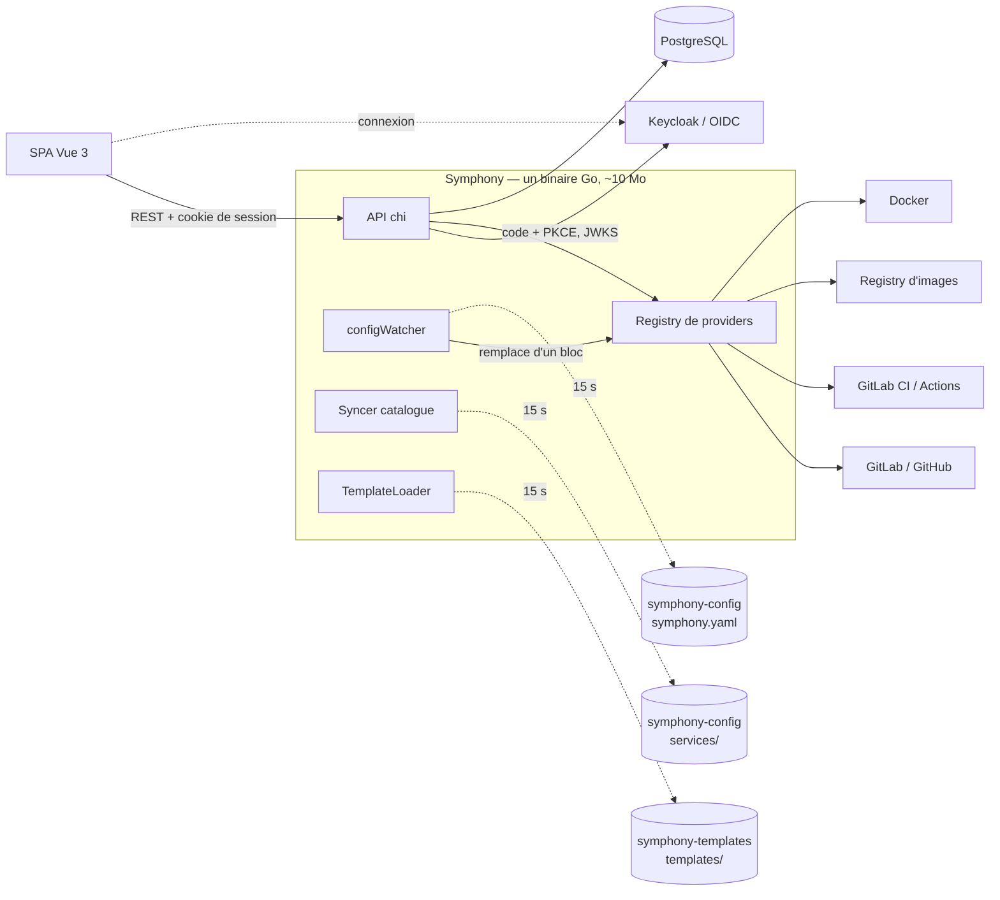

# Symphony

[](https://github.com/clemuscle/symphony/actions/workflows/ci.yml)
[](https://github.com/clemuscle/symphony/releases)

**Une Internal Developer Platform en Go** : un développeur crée un service prêt pour la
production en un clic, à partir d'un *golden path* validé par l'équipe plateforme. Repo,
code, CI, image, déploiement et fiche de catalogue : Symphony s'appuie sur les outils
existants (GitLab ou GitHub, leur CI, un registry, Docker) au lieu de les remplacer.


## Ce que fait Symphony

- **Golden paths** : un template (squelette de code, Dockerfile, tests, pipeline CI) devient
  un repo GitLab qui se construit tout seul. Ajouter un golden path, c'est pousser un
  dossier dans un repo Git : il est disponible en moins de 15 s, sans redémarrage.
- **Catalogue de services** : équipe, criticité, SLO, liens et actions Day-2 de chaque
  service, versionnés dans Git.
- **Déploiement** : image tirée du registry du projet avec ses identifiants, port stable
  d'une version à l'autre, bascule avec retour automatique à l'ancienne version si la
  nouvelle ne démarre pas.
- **Plateforme pilotée par Git** : la configuration elle-même (providers, repos) est lue
  dans Git et appliquée à chaud ; une version invalide est refusée et l'ancienne reste en
  place.
- **Sécurisé** : connexion OIDC (Keycloak en démo, tout fournisseur OIDC), rôles
  `viewer` / `developer` / `admin` déduits des groupes de l'annuaire, audit de qui a fait
  quoi.
- **Observable** : `/metrics` Prometheus sur l'API, chaque appel à GitLab, GitHub ou Docker
  et chaque rechargement depuis Git.

## Essayer

Prérequis : Docker avec Compose v2, `curl`, `jq`, ~5 Go de RAM libres (GitLab, Keycloak).

```bash
git clone https://github.com/clemuscle/symphony.git && cd symphony
./demo/up.sh        # GitLab CE + runner + Keycloak + PostgreSQL + Symphony (5 à 10 min la 1re fois)
```

Le script affiche les URL et identifiants. Comptes de démo (mot de passe = identifiant) :
`alice` (admin), `bob` (developer), `carol` (viewer), `dave` (sans rôle). Suivre ensuite le
[scénario de démo](demo/SCENARIO.md) (10 min). Ports déjà pris ?
`GITLAB_PORT=18929 REGISTRY_PORT=15050 GITLAB_SSH_PORT=12224 SYMPHONY_PORT=18080 KEYCLOAK_PORT=18180 ./demo/up.sh`.
Arrêt : `./demo/down.sh` (`--purge` pour tout effacer).

## Architecture



Chaque outil est derrière une interface Go (`SCMProvider`, `CIProvider`,
`RegistryProvider`, `RuntimeProvider`) : pas de plugins dynamiques, ajouter un outil c'est
implémenter une interface. Détails, flux et décisions :
[documentation/architecture.md](documentation/architecture.md).

## Quelques choix techniques

| Sujet | Choix |
|---|---|
| Configuration à chaud | Un nouveau jeu de providers est construit à côté puis substitué d'un bloc ; les requêtes en cours finissent avec l'ancien. Les composants de longue durée résolvent leur provider à chaque appel. |
| Templates invalides | Validés au chargement (schéma strict, chemins confinés au dossier du template, fichiers présents, CI compatible avec le SCM) ; un template cassé est ignoré, pas fatal. |
| Bascule de conteneur | Pull **avant** d'arrêter l'ancien ; le nouveau démarre à côté et ne remplace l'ancien que s'il tourne encore après le délai de démarrage. |
| Authentification | Backend-for-Frontend : Symphony fait le flux OIDC (code + PKCE) et ne donne au navigateur qu'un cookie signé `HttpOnly` ; rôle recalculé à chaque requête depuis les groupes, CSRF bloqué par contrôle d'origine. Jetons `Bearer` pour les scripts. |
| Sécurité des actions | Les entrées d'une action Day-2 sont validées contre leur déclaration ; une clé non déclarée est refusée (pas d'injection de variables CI). Les identifiants du registry ne partent que vers le registry qui héberge l'image. |
| Dépendances | API Docker appelée directement sur le socket (pas de SDK), `database/sql` sans ORM, front embarqué avec `go:embed`, image `scratch`. |
| Métriques | Routes étiquetées par motif chi (séries bornées) ; appels aux providers mesurés par des décorateurs, sans toucher aux implémentations. |

## Développer

```bash
go test -race ./...
cd frontend && npm install && npm run build && cd ..   # front embarqué au prochain go build
go run ./cmd/symphony                                  # lit symphony.yaml (bootstrap) et .env
```

Le `symphony.yaml` local n'est qu'un bootstrap qui pointe vers le repo de configuration ;
sans section `config_source`, il est lu comme une configuration complète (hors ligne).

## Feuille de route

Fait : v0.1 (binaire unique, `/metrics`, CI et image publiée), v0.2 (démo), v0.3 (OIDC,
rôles, audit). À venir : Kubernetes en GitOps (k3d + Argo CD), opérations Day-2
asynchrones, Vault. Détail : [ROADMAP.md](ROADMAP.md) et
[CHANGELOG.md](CHANGELOG.md).

**Stack** : Go 1.22+, chi, go-oidc, PostgreSQL, Prometheus client, Vue 3 + Vite, GitLab CE,
Keycloak, Docker.
