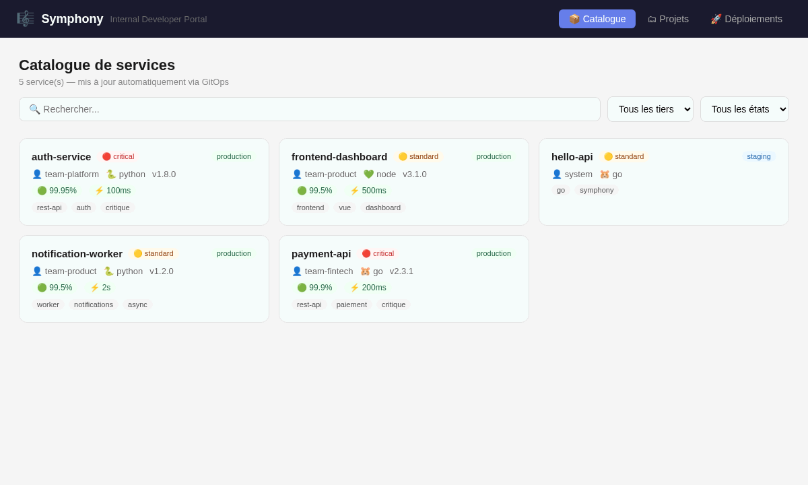
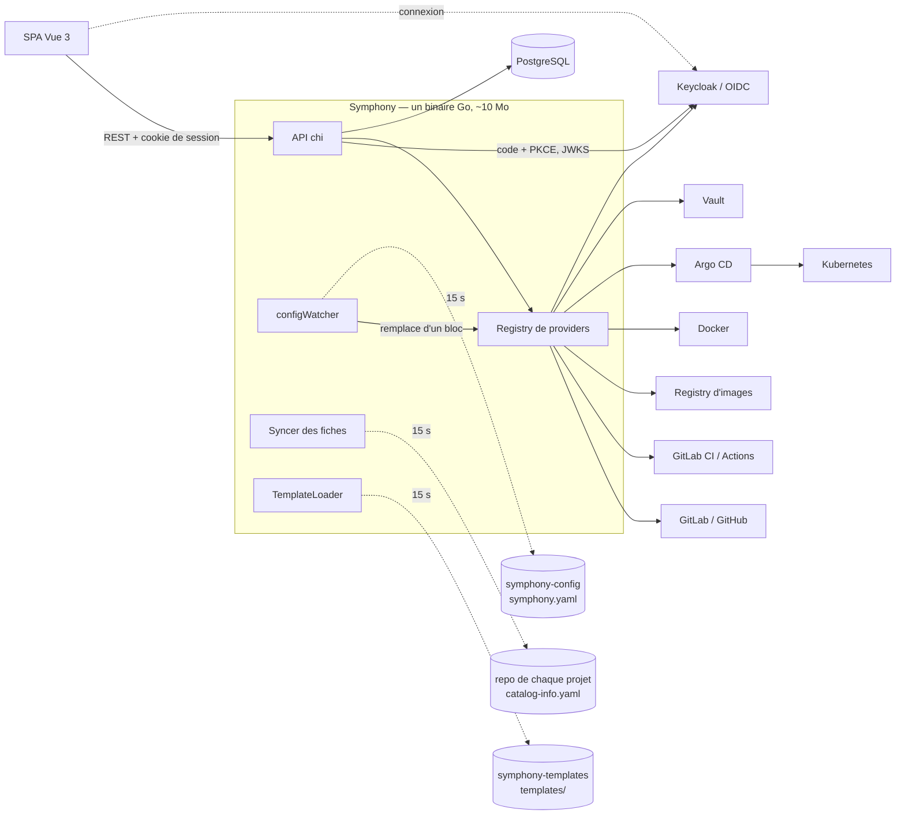

# Symphony

[](https://github.com/clemuscle/symphony/actions/workflows/ci.yml)
[](https://github.com/clemuscle/symphony/releases)

**Une Internal Developer Platform en Go** : un développeur crée un service prêt pour la
production en un clic, à partir d'un *golden path* validé par l'équipe plateforme. Repo,
code, CI, image, déploiement et fiche de catalogue : Symphony s'appuie sur les outils
existants (GitLab ou GitHub, leur CI, un registry, Docker, Argo CD, Vault, Keycloak) au lieu
de les remplacer.



## Ce que fait Symphony

- **Golden paths** : un template (squelette de code, Dockerfile, tests, pipeline CI) devient
  un repo GitLab ou GitHub qui se construit tout seul (GitLab CI ou GitHub Actions, image
  dans le registry GitLab ou sur GHCR). Ajouter un golden path, c'est pousser un
  dossier dans un repo Git : il est disponible en moins de 15 s, sans redémarrage.
- **Projets et leur fiche** : équipe, criticité, SLO, dépendances, liens et actions Day-2
  de chaque service, dans un `catalog-info.yaml` à la racine de son propre repo, que son
  équipe tient à jour comme le reste du code. La page Projets les réunit avec le repo, les
  pipelines et l'URL où chaque service répond.
- **Déploiement sur Kubernetes en GitOps** : Symphony commite les manifests du service dans
  un repo de déploiement et crée l'`Application` Argo CD ; Argo CD applique, corrige les
  dérives, et l'UI affiche son état (Synced, Healthy). Symphony n'a aucun accès au cluster.
- **Déploiement Docker** pour aller vite en local : port stable d'une version à l'autre,
  bascule quand la nouvelle version est `healthy` (le `HEALTHCHECK` de l'image), retour
  automatique à l'ancienne sinon.
- **Opérations suivies en direct** : création, déploiement, suppression et actions Day-2
  sont des tâches qui survivent à un redémarrage ; l'UI montre chaque étape en temps réel
  (Server-Sent Events), poussée par les webhooks de pipeline de GitLab.
- **Plateforme pilotée par Git** : la configuration elle-même (providers, repos) est lue
  dans Git et appliquée à chaud ; une version invalide est refusée et l'ancienne reste en
  place.
- **Sécurisé** : connexion OIDC (Keycloak en démo, tout fournisseur OIDC), rôles
  `viewer` / `developer` / `admin` déduits des groupes de l'annuaire, audit de qui a fait
  quoi. En démo, GitLab se connecte au même Keycloak : un seul compte pour les deux.
- **Aucun secret dans la configuration** : elle désigne ses jetons par référence
  (`secret://vault/symphony/gitlab#token`), lus dans Vault (AppRole) et relus à chaud
  après une rotation.
- **Tout est un provider** : SCM, CI, registry, runtime, secrets et identité ont chacun
  leur interface et leur section de configuration ; l'annuaire Keycloak propose les
  équipes propriétaires à la création d'un projet.
- **Observable** : `/metrics` Prometheus sur l'API, chaque appel à GitLab, GitHub ou Docker
  et chaque rechargement depuis Git.

## Essayer

Prérequis : Docker avec Compose v2, `curl`, `jq`, ~6 Go de RAM libres (GitLab, Keycloak,
Vault, k3s et Argo CD ; `--no-k8s` en économise 1,5 Go).

```bash
git clone https://github.com/clemuscle/symphony.git && cd symphony
./demo/up.sh        # GitLab CE, runner, Keycloak, Vault, PostgreSQL, k3s + Argo CD, Symphony, projets de démo (15 min la 1re fois)
```

Le script affiche les URL et identifiants. Comptes de démo, pour Symphony comme pour
GitLab (bouton « Keycloak ») et mot de passe = identifiant : `alice` (admin), `bob`
(developer), `carol` (viewer), `dave` (sans rôle). Trois projets sont déjà créés et
déployés depuis les golden paths, avec leur repo, leurs pipelines et leur URL
(`--no-seed` pour partir de zéro). Suivre ensuite le [scénario de démo](demo/SCENARIO.md)
(15 min). Ports déjà pris ? `up.sh` dit lequel, et comment le changer
(`K8S_API_PORT=16443 ./demo/up.sh`, par exemple).
Avec `GITHUB_TOKEN=<jeton> ./demo/up.sh`, la démo ajoute GitHub et le golden path
`api-rest-go-github` (repo dans ton compte, GitHub Actions, image sur GHCR) ; jeton
classique avec les droits `repo`, `workflow`, `delete_repo` et `read/write/delete:packages`.
Arrêt : `./demo/down.sh` (`--purge` pour tout effacer).

## Architecture



Chaque outil est derrière une interface Go (`SCMProvider`, `CIProvider`,
`RegistryProvider`, `RuntimeProvider`, `SecretsProvider`, `IdentityProvider`) : pas de
plugins dynamiques, ajouter un outil c'est
implémenter une interface. Détails, flux et décisions :
[documentation/architecture.md](documentation/architecture.md).

## Quelques choix techniques

| Sujet | Choix |
|---|---|
| Configuration à chaud | Un nouveau jeu de providers est construit à côté puis substitué d'un bloc ; les requêtes en cours finissent avec l'ancien. Les composants de longue durée résolvent leur provider à chaque appel. |
| Templates invalides | Validés au chargement (schéma strict, chemins confinés au dossier du template, fichiers présents, CI compatible avec le SCM) ; un template cassé est ignoré, pas fatal. |
| Bascule de conteneur | Pull **avant** d'arrêter l'ancien ; le nouveau démarre à côté et ne remplace l'ancien qu'une fois `healthy` (`HEALTHCHECK` de l'image ; sans healthcheck, s'il tourne encore après 3 s). |
| Configuration stricte | `symphony.yaml` décodé sans tolérance : chaque type de provider déclare ses clés, une faute de frappe ou une clé requise absente fait refuser la configuration (la précédente reste en place), avec toutes les erreurs d'un coup. Les configurations livrées sont validées par la CI. |
| Erreurs | Le client reçoit l'opération en échec et l'identifiant de requête ; le détail (SQL, réponse brute d'un provider) ne quitte pas les logs. |
| Secrets | Références `secret://<provider>/<chemin>#<clé>` résolues dans une copie de la configuration, tout ou rien : un coffre injoignable laisse la configuration en place. L'empreinte de la configuration résolue détecte une rotation. |
| Authentification | Backend-for-Frontend : Symphony fait le flux OIDC (code + PKCE) et ne donne au navigateur qu'un cookie signé `HttpOnly` ; rôle recalculé à chaque requête depuis les groupes, CSRF bloqué par contrôle d'origine. Jetons `Bearer` pour les scripts. |
| Sécurité des actions | Les entrées d'une action Day-2 sont validées contre leur déclaration ; une clé non déclarée est refusée (pas d'injection de variables CI). Les identifiants du registry ne partent que vers le registry qui héberge l'image. |
| Dépendances | API Docker appelée directement sur le socket (pas de SDK), `database/sql` sans ORM, front embarqué avec `go:embed`, image `scratch`. |
| Tâches | Étapes enregistrées en base et rejouables : une création interrompue par un redémarrage reprend sans recréer le repo. L'attente d'une pipeline ne bloque aucun thread : un webhook (ou le sondage de secours) relance la tâche. |
| Métriques | Routes étiquetées par motif chi (séries bornées) ; appels aux providers mesurés par des décorateurs, sans toucher aux implémentations. |

## Développer

```bash
go test -race ./...
cd frontend && npm install && npm run build && cd ..   # front embarqué au prochain go build
go run ./cmd/symphony                                  # lit symphony.yaml (bootstrap) et .env
```

Le `symphony.yaml` local n'est qu'un bootstrap qui pointe vers le repo de configuration ;
sans section `config_source`, il est lu comme une configuration complète (hors ligne).

## Feuille de route

Fait : v0.1 (binaire unique, `/metrics`, CI et image publiée), v0.2 (démo), v0.3 (OIDC,
rôles, audit), v0.4 (Kubernetes en GitOps avec Argo CD), v0.5 (tâches asynchrones,
webhooks, temps réel), v0.6 (vrais projets de démo, fiche catalogue dans le repo du projet,
connexion unique à GitLab), v0.7 (secrets et identité en providers : Vault, Keycloak et
son annuaire ; golden path GitHub de bout en bout ; bascule Docker sur le `HEALTHCHECK`).
Détail : [ROADMAP.md](ROADMAP.md) et [CHANGELOG.md](CHANGELOG.md).

**Stack** : Go 1.27, chi, go-oidc, PostgreSQL, Prometheus client, Vue 3 + Vite, GitLab CE,
Keycloak, Vault, Docker, k3s, Argo CD.
